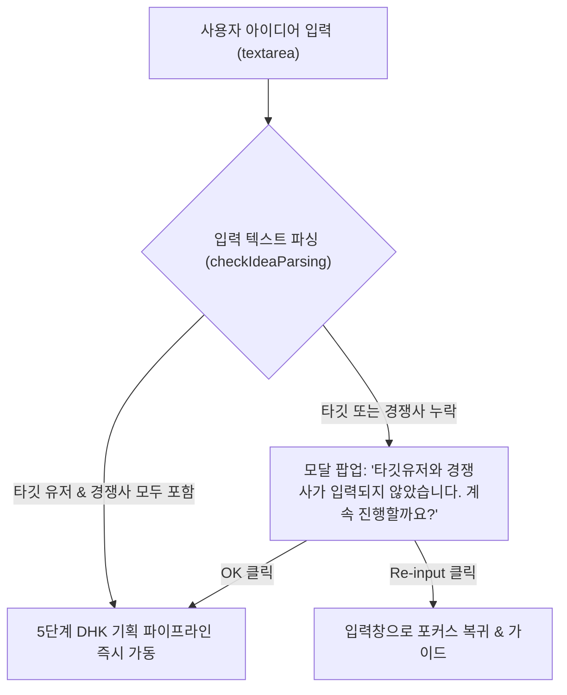

# [PITL - Planning In The Loop] 시스템 및 기능 명세서 (Functional Specification)

> **문서 버전:** v2.5.0  
> **최종 갱신일:** 2026-08-22  
> **목적:** 작가 `drbrooks`의 인문학적·성찰적 기획 방법론(DHK 5단계)과 고성능 다중 에이전트 파이프라인(1-Pager, 3C, SWOT, STP, MECE, PRD, 와이어프레임 3안, 갤럭시 Z 폴드 8 인터랙티브 프로토타입, QA 감사)을 다른 AI 툴이나 개발 환경에서도 100% 동일하게 재현 및 구축할 수 있도록 정의한 통합 지침서.

---

## 1. 시스템 아키텍처 개요 (System Architecture)

### 1.1. 듀얼 실행 모드 (Dual Execution Engine)
- **Direct Client-Side Mode (기본 모드)**:
  - 브라우저 단일 HTML5 (`index.html`) 내에서 순수 JavaScript로 동작.
  - 사용자가 입력한 Gemini API Key를 `localStorage`에 암호화 보관 후 클라이언트에서 Google Gemini REST API (`https://generativelanguage.googleapis.com/v1beta/models/...`)를 직접 호출.
  - 외부 백엔드 서버 없이 완전한 오프라인/스탠드얼론 실행 가능 (API 실패 시 지능형 Fallback 템플릿 엔진 자동 구동).
- **Backend Proxy Server Mode (선택적 구동)**:
  - Node.js 기반 `server.js` (Express + `@google/genai` SDK)를 통해 기획 이력 파일 시스템(`outputs/` 디렉토리) 저장 및 REST API 제공.

### 1.2. 기술 스택 (Tech Stack)
- **Frontend**: 순수 HTML5, CSS3 (CSS Variables, Flexbox/Grid, Glassmorphism, 3D Canvas), Vanilla JavaScript (ES6+).
- **외부 CDN 라이브러리**:
  - `marked.min.js`: 마크다운 렌더링 엔진
  - `FontAwesome 6.5.1`: 글로벌 아이콘 시스템
  - Google Web Fonts: `Plus Jakarta Sans`, `Space Grotesk`, `Noto Sans KR`, `Fira Code`

---

## 2. 디자인 시스템 (Starbucks × Dark Roasted Coffee Blend)

### 2.1. 컬러 팔레트 시스템 (CSS Variables)
| 토큰명 | 색상값 (Hex / RGBA) | 용도 및 설명 |
| :--- | :--- | :--- |
| `--sb-green` | `#006241` | 스타벅스 코어 그린 (Light 테마 강조 및 버튼) |
| `--sb-accent` | `#00754A` | 스타벅스 시그니처 액센트 그린 (포커스, 뱃지, 프로그레스 링) |
| `--sb-house` | `#1E3932` | 하우스 그린 (다크 테마 카드 및 구조 배경) |
| `--sb-coffee-roast` | `#1a120e` | 다크 에스프레소 로스트 베이스 |
| `--sb-coffee-bean` | `#362219` | 로스팅 커피 원두 브라운 틴트 |
| `--sb-coffee-glow` | `#4a2e21` | 따뜻한 앰버 커피 글로우 |
| `--sb-gold-roast` | `#cba258` | 스타벅스 앰버 골드 로스트 액센트 |
| `--accent-neon` | `#00754A` / `#34d399` | 다크모드 하이 콘트라스트 진행률 및 액티브 인디케이터 |

### 2.2. 테마 모드별 배경 캔버스 (Ambient Backgrounds)
- **Dark Theme (House Green & Dark Roasted Coffee Fusion)**:
  ```css
  body.dark-theme {
      background-color: #0b1411;
      background-image:
          radial-gradient(ellipse 80% 60% at 10% 0%, rgba(0, 117, 74, 0.22) 0%, transparent 60%),
          radial-gradient(ellipse 65% 55% at 90% 100%, rgba(66, 43, 34, 0.38) 0%, transparent 60%),
          radial-gradient(ellipse 50% 50% at 50% 50%, rgba(26, 18, 14, 0.28) 0%, transparent 80%);
      color: #f8fafc;
  }
  ```
- **Light Theme (Café Cream & Ceramic Material)**:
  - 배경: `#f2f0eb` (Warm Canvas), 사이드바: `#edebe9`, 카드: `#ffffff`, 보더: `#d4e9e2` (Mint Hairline).

### 2.3. 컴포넌트 시각 규칙
- **버튼 (Buttons)**: `border-radius: 50px` (Full Pill), 클릭 시 `transform: scale(0.95)` 프레스 피드백.
- **랜딩 배경**: 인터랙티브 3D Space Particle Network (`<canvas id="space-particle-canvas">`, 마우스 인터랙션 파티클 연결선 렌더링).
- **마크다운 인핸서**:
  - `==텍스트==` 문법을 감지하여 스타벅스 그린/골드 그라데이션 `<mark>` 하이라이트로 렌더링.
  - GitHub 스타일 콜아웃 카드 (`> [!NOTE]`, `> [!IMPORTANT]`, `> [!WARNING]`).
  - Monospace ASCII 다이어그램 pre/code 블록: `Fira Code`, `letter-spacing: 0`, `overflow-x: auto`, `white-space: pre !important`.

---

## 3. 사용자 입력 및 유효성 검증 프로세스 (User Flow)



1. **대형 문단 입력창**: 높이 `130px` (최소 120px), 플레이스홀더: `"아이디어/타겟유저/경쟁사를 입력하세요."`
2. **지능형 파싱 검증 (`checkIdeaParsing`)**:
   - 키워드 분석 정규식으로 타깃 대상(타깃, 고객, 사용자, 20대 등)과 경쟁사(경쟁, 대비, vs 등) 존재 여부 체크.
   - 누락 시 커스텀 확인 모달(`showValidationConfirmModal`) 표출하여 'OK(계속 진행)' 또는 'Re-input(다시 입력)' 분기.

---

## 4. 8단계 기획 파이프라인 및 에이전트 명세 (Agent Pipeline)

### 4.1. 기획 단계 및 진행률 매핑
| 단계 키 | 산출물 명칭 | 담당 에이전트 | 진행률 | 검토 게이트 |
| :--- | :--- | :--- | :--- | :--- |
| `1pager` | 1-Pager 비즈니스 요약서 | **Product Strategist** | 0% → 15% | Phase 1 (구조화) |
| `threec` | 3C 입체적 환경 분석서 | **Product Strategist** | 15% → 30% | Phase 1 (구조화) |
| `swot` | SWOT 4분면 및 TOWS 교차 전략 | **Product Strategist** | 30% → 45% | Phase 1 (구조화) |
| `stp` | STP 마케팅 & 2축 포지셔닝 맵 | **Product Strategist** | 45% → 55% | Phase 1 (구조화) |
| `mece` | McKinsey MECE 5대 도메인 구조화 | **Product Analyst** | 55% → 60% | Phase 1 완료 |
| **`gate50`** | **50% 사용자 중간 검토 게이트** | **오케스트레이터 (Gatekeeper)** | **50% 대기** | **사용자 승인 시 재개** |
| `prd` | PRD 개발 요구사항 명세서 | **Product Analyst** | 60% → 75% | Phase 2 (구체화) |
| `wireframe` | 와이어프레임 3안 (Type A/B/C) | **UX Architect** | 75% → 85% | Phase 2 (구체화) |
| `prototype` | **Galaxy Z Fold 8 인터랙티브 프로토타입** | **Frontend Engineer** | 85% → 95% | Phase 2 (구체화) |
| `audit` | 삼각 정합성 QA 감사 보고서 | **Product Reviewer** | 95% → 100% | 최종 완료 |

---

### 4.2. 각 단계별 프롬프트 및 산출물 구조 가이드

#### ① 1-Pager (DHK 5단계 기획 방법론 & drbrooks 에세이 융합)
- **에세이 지식 융합 (`drbrookskim/thoughts/brunch_articles`)**: GitHub API로 실시간 에세이 통찰 관점(5Why 본질, 이상/현실 공간 핍진성, 오컴의 면도날 가지치기, 브랜드 명분)을 추출하여 주입. *(단, 파일명 및 넘버링_제목은 언급하지 않음)*
- **필수 마크다운 섹션**:
  ```markdown
  ## 0. 성찰적 기획 인사이트 (Reflective Insight)
  ## 1. 프로젝트 한 줄 요약 (핵심 메시지)
  ## 2. 왜(Why) — 본질적 니즈 및 5 Why 분석
  ## 3. 개념 (Concept) — 핵심 가치, 이점 및 포지셔닝 렌즈
  ## 4. 시나리오 (Scenario) — 사용자 여정, 페인포인트 및 개념 전환 해결책
  ## 5. 핵심 목표 (KPI & 메트릭 테이블)
  ## 6. 가지치기 (Pruning) & 가치 검증 (Must-have vs Nice-to-have)
  ## 7. 실행 로드맵 & 리스크 대응 방안 (Phase 1/2/3 테이블)
  ## 8. 기획 검증 및 스토리텔링 결언
  ```

#### ② 3C Framework (Customer, Competitor, Company)
- **필수 섹션**:
  - Customer: 페르소나별 3개 이상의 구체적 하루 일과 터치포인트 시나리오.
  - Competitor: 가격, 추정 MAU/DAU, 기능 공백 비교 테이블.
  - Company: 보유 핵심 기술 및 차별화 자산.
  - Strategic White Space: 3C 교집합 벤다이어그램 구조 설명.

#### ③ SWOT & TOWS Cross Matrix
- **필수 섹션**:
  - 2×2 요약 매트릭스 테이블 (강점, 약점, 기회, 위협).
  - TOWS 4대 교차 전략: **SO(공격)**, **ST(차별화/방어)**, **WO(보완)**, **WT(생존/회피)** 실행 우선순위 및 로드맵.

#### ④ STP Marketing & 2축 포지셔닝 맵
- **필수 섹션**:
  - Segmentation (추정 시장 규모 수치).
  - Targeting (페르소나 7단계 Journey Map, TAM/SAM/SOM).
  - **Positioning (ASCII 코드 블록 2D 그리드)**:
    ````markdown
    ```ascii
                         ^ (Y축: 기능 접근성 High)
                         |
            [경쟁사 A]   |   [★ 자사 (Blue Ocean Zone)]
                         |
    <--------------------+--------------------> (X축: 가격 합리성 High)
                         |
            [경쟁사 B]   |   [대체재 C]
                         |
                         v (Y축: 기능 접근성 Low)
    ```
    ````

#### ⑤ McKinsey MECE 5대 도메인 구조화
- **5대 도메인**: 고객 세분화 트리, 경쟁 환경 축, 시장 진입 전략(Ansoff 4분면), 자사 역량 체계, 가치 사슬(Value Chain).
- **구조 검증**: 각 분해 레벨에서 상호배제(ME)와 전체포괄(CE) 검증 문구 수록.

#### ⑥ 50% Gate 중간 검토 (Gatekeeper)
- MECE 완료 시 자동으로 생성을 일시 정지하고 `resumePlanningAfterMece()` 액션 버튼 노출. 사용자가 검토 후 승인하면 PRD 단계로 이어짐.

#### ⑦ PRD (Product Requirements Document)
- Google/Meta 수준의 요구사항 명세서.
- 고유 `REQ-ID`, `Given-When-Then` 인수 조건, `MoSCoW` 우선순위, Happy Path 3개 및 Edge Case 5개 에러 피드백 명시.

#### ⑧ 와이어프레임 3안 (Wireframe 3 Options)
- **Type A (현실/안정형)**: 검증된 표준 3단 그리드 레이아웃.
- **Type B (디자인/감성 몰입형)**: 비주얼 중심 카드 레이아웃.
- **Type C (실험적/미래형)**: 동적 위젯 모듈 레이아웃.
- 탭 버튼 클릭 시 즉시 ASCII 구조 시안 전환.

---

## 5. 삼성 갤럭시 Z 폴드 8 단말기 프로토타입 뷰어 (Foldable Prototype)

```
┌─────────────────────────────────────────────────────────────┐
│  Galaxy Z Fold 8 폼팩터 모드 스위처 (Toolbar)               │
│  [📖 메인 대화면 (740×780)] [📱 커버 (380×800)] [📐 플렉스]  │
├─────────────────────────────────────────────────────────────┤
│                                                             │
│       ┌─────────────────────────────────────────────┐       │
│       │ 12:45                             5G 98% [■]│ ◀ 상태바  │
│       ├──────────────────────┬──────────────────────┤       │
│       │                      │                      │       │
│       │  [좌측 사이드 패널]    │ [우측 메인 워크스페이스]│       │
│       │  • 퀵 네비게이션     │ • 히어로 카드 배너   │       │
│       │  • 필터 칩           │ • 인터랙티브 폼/피드  │       │
│       │  • 통계 위젯         │ • 실시간 시뮬레이터  │       │
│       │                      │                      │       │
│       ├──────────────────────┴──────────────────────┤       │
│       │                  ───────                    │ ◀ 제스처바 │
│       └─────────────────────────────────────────────┘       │
│                    중앙 힌지 라인 (Crease)                    │
└─────────────────────────────────────────────────────────────┘
```

### 5.1. 폼팩터 모드 구성
1. **메인 대화면 모드 (`mode-main`, 기본값)**:
   - 해상도: **740px × 780px** (8.0인치 대화면 6:5 비율).
   - **UDC (Under Display Camera)** 기술 반영: 상단 카메라 구멍 없이 완전한 무결점 풀스크린 렌더링.
   - 중앙 미세 힌지 라인(Crease Line) 섀도우 효과.
   - 멀티태스킹 2-Column 반응형 레이아웃 뷰.
2. **커버 스크린 모드 (`mode-cover`)**:
   - 해상도: **380px × 800px** (23.1:9 슬림 스마트폰 비율).
   - 상단 중앙 **Infinity-O 펀치홀 카메라 (`.device-punch-hole`)** 렌즈 활성화.
   - 1-Column 모바일 원스크린 및 하단 네비게이션 바.
3. **플렉스 모드 (`mode-flex`)**:
   - 해상도: **580px × 720px** (3D Perspective 12° 기울기 L자 반접힘 거치 뷰).
4. **전체화면 모드 (`mode-desktop`)**:
   - 디바이스 프레임을 해제하고 100% 가득 찬 데스크톱 뷰.

### 5.2. 순수 HTML 추출 엔진 (`extractPureHtmlCode`)
- AI 생성 결과물에서 ````html ... ```` 마크다운 블록 또는 `<!DOCTYPE html>` 태그를 감지하여 순수 HTML/CSS/JS 코드만 정제 추출.
- 마크다운 설명글만 온 경우에도 갤럭시 폴드 전용 풀스택 인터랙티브 웹앱(토스트 알림, 항목 추가 시뮬레이터, 칩 필터, 모달)으로 자동 래핑하여 100% 렌더링 보장.

---

## 6. QA 감사 및 추적 가능성 (Traceability Matrix)

- **삼각 정합성(Triangular Consistency) 검증**:
  - `1-Pager 비즈니스 목표` ↔ `PRD REQ-ID` ↔ `와이어프레임 CTA 버튼` 간 100% Traceability 테이블 작성.
- **Gap Analysis**:
  - 누락(Missing), 모순(Conflict), 과잉(Excess) 요건 식별 및 정량 매칭률 산출.
  - 조치 등급: 즉시 조치 필요(Critical), 개선 권고(Major), 참고(Minor).

---

## 7. 저장소 및 데이터 인터페이스 (Storage & State)

### 7.1. 로컬 스토리지 구조 (`localStorage`)
- `pitl_gemini_api_key`: 사용자 암호화 저장 API 키.
- `pitl_theme`: `'dark'` | `'light'` 테마 상태.
- `pitl_history_v2`: 생성된 기획서 문서 묶음 배열 (타임스탬프, 타이틀, 8종 문서 본문).

### 7.2. 생성 문서 객체 구조 (`generatedDocs`)
```json
{
  "title": "프로젝트_제목",
  "idea": "사용자 원본 입력 아이디어",
  "1pager": "## 0. 성찰적 기획 인사이트...",
  "threec": "## 1. 3C 및 전략 요약...",
  "swot": "## 1. SWOT 개요...",
  "stp": "## 1. Segmentation...",
  "mece": "## 1. 개요 및 구조화 목적...",
  "prd": "# [26.08.22] 요구사항 명세서...",
  "wireframe": "## Type A: 안정형 레이아웃...",
  "prototype": "<!DOCTYPE html><html>...</html>",
  "audit": "## 1. 삼각 정합성 검증 결과..."
}
```

---

## 8. 타 플랫폼 및 툴 적용을 위한 재현 지침 (How to Replicate)

1. **단일 HTML 구동 환경 구축**:
   - `index.html` 내부에 상기 명시된 CSS Variables, Space Particle Canvas, Device Frame CSS를 배치.
2. **프롬프트 템플릿 복제**:
   - 본 문서의 4장의 시스템 프롬프트 및 DHK 5단계 구조화 규칙을 각 단계별 LLM 호출 체인에 바인딩.
3. **50% Gatekeeper 인터럽트 로직 구현**:
   - 5단계(MECE) 완료 후 자동으로 일시 정지하고 사용자의 '진행' 클릭 시 6~9단계를 실행하는 비동기 스테이트 머신(`resumePlanningAfterMece`) 구성.
4. **갤럭시 Z 폴드 8 뷰포트 바인딩**:
   - 7단계 프로토타입 출력물을 `extractPureHtmlCode()`로 정제 후 `srcdoc` 또는 Blob URL로 iframe에 격리 탑재하고 모드 스위처(Main/Cover/Flex) 연결.
